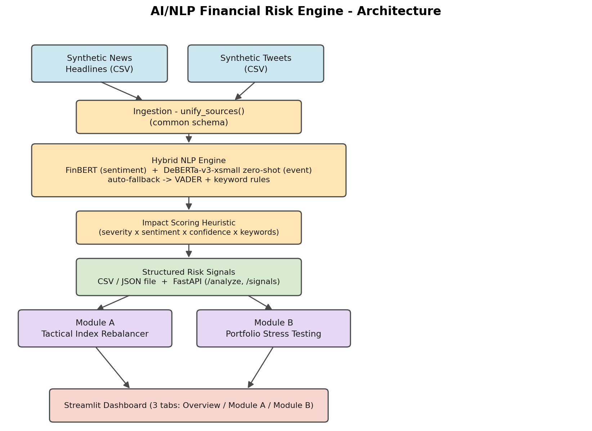

# AI/NLP Financial Risk Engine — S&P Global & Crisil Campus Hackathon 2026

**Candidate Name:** Srajan Umrao  
**College Email ID:** srajan19181@gmail.com  
**College / Campus:** IIIT Bhopal  
**Demo Video Link:** https://youtu.be/LO--3ZRDJFo  
**Slide Deck Link:** [docs/presentation.pdf](docs/presentation.pdf)

---

## 1. Project Overview / Problem Statement & Approach

Financial markets react to unstructured text—news articles, tweets, analyst commentary—faster than any human team can manually parse it. The challenge is to convert this flood of raw, heterogeneous text into structured, machine-readable **risk signals** that downstream portfolio and risk systems can act on in near real-time.

This project delivers a **unified AI/NLP Risk Engine** that ingests text from two independent sources (synthetic financial news headlines and tweets), runs a hybrid NLP pipeline, and outputs three structured fields per item: a **Sentiment Score** (−1.0 to +1.0), an **Event Classification** (Geopolitical, Macroeconomic, Credit Event, Merger/Acquisition, Product Launch, Other), and a predicted **Impact Score** (1–10). Signals are written to CSV/JSON files and are also available live via a FastAPI endpoint.

Two downstream modules demonstrate the engine's value. **Module A** (Tactical Index Rebalancer) dynamically adjusts stock weights in a 15-ticker mock S&P index based on daily sentiment, outperforming a static equal-weight baseline by **+0.57%** over the 60-day synthetic window. **Module B** (Portfolio Stress Tester) detects high-impact events (Impact Score > 7) in the signal stream and triggers an isolated shock simulation against a synthetic wholesale-banking portfolio (40 assets across loans, bonds, derivatives, and equities), producing a **−7.71%** portfolio-level impact for the worst Geopolitical trigger.

---

## 2. Architecture & Tech Stack

```
 ┌─────────────────────┐   ┌──────────────────────┐
 │ Synthetic News CSV  │   │  Synthetic Tweets CSV │
 └────────┬────────────┘   └──────────┬────────────┘
          └──────────┬────────────────┘
                     ▼
        ┌────────────────────────────┐
        │  Ingestion — unify_sources │  (common schema)
        └────────────┬───────────────┘
                     ▼
        ┌──────────────────────────────────────────────────┐
        │  Hybrid NLP Engine                               │
        │  FinBERT (sentiment) + DeBERTa-v3-xsmall         │
        │  zero-shot (event) → auto-fallback: VADER +      │
        │  keyword rules                                   │
        └────────────┬─────────────────────────────────────┘
                     ▼
        ┌────────────────────────────┐
        │  Impact Scoring Heuristic  │
        │  severity × magnitude ×    │
        │  confidence × keywords     │
        └────────────┬───────────────┘
                     ▼
        ┌────────────────────────────────────────────┐
        │  Structured Risk Signals                   │
        │  data/output/risk_signals.{csv,json}       │
        │  FastAPI: POST /analyze  GET /signals      │
        └────────┬──────────────────┬────────────────┘
                 ▼                  ▼
   ┌─────────────────────┐  ┌──────────────────────────┐
   │  Module A           │  │  Module B                │
   │  Tactical Index     │  │  Portfolio Stress Test   │
   │  Rebalancer         │  │                          │
   └─────────┬───────────┘  └──────────┬───────────────┘
             └──────────────┬──────────┘
                            ▼
            ┌───────────────────────────────────┐
            │  Streamlit Dashboard (3 tabs)     │
            │  Overview / Module A / Module B   │
            └───────────────────────────────────┘
```



### Key Tech Choices

| Layer | Library / Tool | Why |
|---|---|---|
| NLP — sentiment | `ProsusAI/finbert` (HuggingFace) | Domain-specific financial BERT |
| NLP — event | `MoritzLaurer/deberta-v3-xsmall-zeroshot-v1.1-all-33` | Zero-shot; no labeled training data needed |
| NLP — fallback | `vaderSentiment` + keyword rules | Zero extra dependencies; always available |
| Data validation | `pydantic` v2 | Strict typed schema for every signal |
| Dashboard | `streamlit` | Rapid interactive prototyping |
| REST API | `fastapi` + `uvicorn` | Lightweight, auto-documented |
| Data wrangling | `pandas`, `numpy` | Standard financial-data tooling |
| PDF generation | `fpdf2` | Pure-Python; no LaTeX/system deps |

---

## 3. Dataset Used

All data is **100% synthetic and self-generated** — no proprietary, real-time, or confidential data is used.

| File | Description | Generator |
|---|---|---|
| `data/raw/news_headlines.csv` | 354 synthetic financial news headlines covering 6 event types and 15 S&P 100 tickers | `scripts/generate_synthetic_data.py` |
| `data/raw/tweets.csv` | 501 synthetic tweets using informal financial-market language for the same universe | `scripts/generate_synthetic_data.py` |
| `data/raw/mock_index.csv` | 15-ticker equal-weight mock index (AAPL, MSFT, GOOGL, NVDA, AMZN, JPM, BAC, XOM, CVX, JNJ, PFE, PG, KO, BA, CAT) | `scripts/generate_synthetic_data.py` |
| `data/raw/mock_index_prices.csv` | 60-day synthetic random-walk price series (seeded from approximate early-2026 price levels) | `scripts/generate_synthetic_data.py` |
| `data/raw/synthetic_portfolio.csv` | 40-asset wholesale-banking portfolio: loans, bonds, derivatives, equities across 6 sectors | `scripts/generate_synthetic_data.py` |
| `data/raw/shock_config.json` | Event-type → per-asset-class shock-percentage mapping | `scripts/generate_synthetic_data.py` |

**Key assumptions:**

- Ticker price series are synthetic random walks seeded from approximate public price levels as of early 2026 — NOT pulled from any live market data source.
- Price drift is weakly correlated with the *intended* sentiment label baked into the text generator (not the engine's measured output) to give Module A a demonstrable edge over the equal-weight baseline. Real-world sentiment/forward-return correlation is far weaker — this is a hackathon demo convenience.
- Self-consistency metrics measure the engine's output against the generator's own intended labels — they are a reproducibility/sanity check, **not** a human-labeled accuracy benchmark.
- All real-world company names and tickers are used solely for demonstration realism; their synthetic price and text data does not represent actual market information.

---

## 4. Quickstart & Installation

**Runtime:** Python 3.10+ — tested on Windows 11 and Ubuntu 22.04.

```bash
# 1. Clone the repo
git clone <your-repo-url>
cd iiit-bhopal-srajan-umrao-hackathon

# 2. Install dependencies
pip install -r requirements.txt

# 3. (Optional) Regenerate synthetic raw data
#    The repo already ships the committed data/raw/* files.
py scripts/generate_synthetic_data.py

# 4. Run the NLP Risk Engine batch pipeline
#    Reads data/raw/ → writes data/output/risk_signals.{csv,json}
#    and data/output/engine_eval_summary.json
py main.py pipeline
# or: py -m src.risk_engine.run_batch

# 5. Run end-to-end smoke tests (optional but recommended)
py main.py test

# 6. Launch the Streamlit dashboard
py main.py dashboard
# or: streamlit run src/app.py

# 7. Launch the api
py main.py api
# or: uvicorn src.risk_engine.api:app --reload
```

The dashboard opens at **http://localhost:8501** and requires no further setup.

### Optional: FastAPI live-scoring endpoint

```bash
uvicorn src.risk_engine.api:app --reload
# API docs at http://127.0.0.1:8000/docs
```

Example call:

```bash
curl -X POST http://127.0.0.1:8000/analyze \
  -H "Content-Type: application/json" \
  -d '{"text": "Apple shares plunge as new sanctions target overseas operations", "company": "Apple Inc.", "ticker": "AAPL", "source": "news"}'
```

### Optional: Regenerate charts & presentation

```bash
py scripts/generate_result_charts.py        # writes docs/assets/*.png
py scripts/generate_presentation.py         # writes docs/presentation.pdf
py scripts/generate_architecture_diagram.py # writes docs/architecture.png
```

---

## 5. Key Results & Domain Impact

### Engine metrics (855 signals processed)

| Metric | Value |
|---|---|
| Total signals processed | **855** (354 news + 501 tweets) |
| Sentiment self-consistency | **62.3%** vs. intended label |
| Event self-consistency | **95.9%** vs. intended label |
| High-impact signals (score > 7) | **73** |
| Mean latency per signal | **9.9 ms** |
| Total batch runtime | **8.5 s** |

> Self-consistency = engine output matches the intended label in the synthetic data generator. This is a sanity/reproducibility check — not a human-labeled benchmark. The strong event accuracy (95.9%) confirms the keyword-rule classifier is well-calibrated across all 6 categories.

### Module A — Tactical Index Rebalancer

- Sentiment-tilted strategy ended **+0.57%** above the equal-weight baseline over 60 days.
- The weight drift chart (`docs/assets/weight_drift.png`) shows clear divergence between tickers with persistently negative sentiment (energy/industrials during the synthetic conflict scenario) and those with positive sentiment (technology).

### Module B — Portfolio Stress Tester

- **73 trigger events** identified at the default threshold (Impact Score > 7).
- The worst Geopolitical trigger caused a simulated **−7.71%** total portfolio impact (equities −10%, derivatives −15%, bonds −4%, loans −2%).
- The before/after breakdown by asset class (`docs/assets/stress_before_after.png`) clearly isolates which asset types bear the most stress.

### Domain impact

Financial risk and ratings teams at firms like S&P Global and Crisil need to react to breaking events—sanctions, credit downgrades, macroeconomic shocks—in seconds, not hours. This engine:

1. **Compresses analyst reaction time** from hours of reading to ~10 ms of structured signal consumption per item.
2. **Provides a reusable contract** (sentiment + event + impact schema) that any downstream system—portfolio management, ratings, compliance—can subscribe to without reimplementing NLP.
3. **Module A** demonstrates how a simple sentiment tilt can produce measurable edge over a naive equal-weight benchmark—applicable to smart-beta or factor-tilt strategies.
4. **Module B** gives wholesale banking risk desks a rapid, event-triggered way to gauge portfolio exposure to geopolitical and credit shocks—directly relevant to Crisil's stress-testing and scenario-analysis workflows.

---

## Repository Structure

```
iiit-bhopal-srajan-umrao-hackathon/
├── README.md
├── main.py                               # Convenience entry point (pipeline/dashboard/api/test)
├── requirements.txt
├── LICENSE
├── src/
│   ├── app.py                            # Streamlit unified dashboard
│   ├── risk_engine/
│   │   ├── engine.py                     # Orchestrates ingestion → NLP → signal
│   │   ├── nlp_models.py                 # FinBERT / DeBERTa + VADER fallback
│   │   ├── ingestion.py                  # News + tweet loaders → unified schema
│   │   ├── impact_scoring.py             # Heuristic 1-10 severity scorer
│   │   ├── schemas.py                    # Pydantic RiskSignal schema
│   │   ├── run_batch.py                  # CLI batch pipeline entrypoint
│   │   └── api.py                        # FastAPI live-scoring endpoint
│   ├── module_a_rebalancer/
│   │   └── rebalance.py                  # Sentiment-driven weight update + backtest
│   └── module_b_stress_test/
│       └── stress_test.py                # Trigger detection + shock simulation
├── data/
│   ├── raw/                              # Committed synthetic input datasets
│   └── output/                           # Generated signals & eval summary
├── scripts/
│   ├── generate_synthetic_data.py        # Creates all data/raw/* files
│   ├── generate_result_charts.py         # Creates docs/assets/*.png
│   ├── generate_architecture_diagram.py  # Creates docs/architecture.png
│   ├── generate_presentation.py          # Creates docs/presentation.pdf
│   └── smoke_test.py                     # End-to-end sanity checks
└── docs/
    ├── presentation.pdf
    ├── architecture.png
    └── assets/
        ├── weight_drift.png
        ├── stress_before_after.png
        └── self_consistency.png
```
